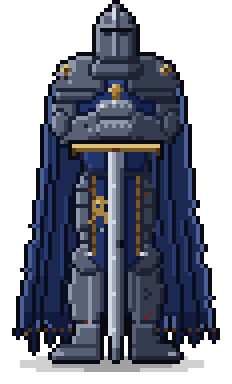

# Sentinel



A battle-worn knight who stands watch on your desktop. Only the figure is visible: there's no window frame, background or toolbar. He stays quietly above your other windows and says a few words only when you ask.

Built with Tauri 2, React and TypeScript. Runs fully offline.

## Installing (Windows)

Instructions to build the installer. You'll need the tools under [Development](#development).

```sh
npm install
npm run tauri build
```

Then run `src-tauri/target/release/bundle/nsis/Sentinel_0.1.0_x64-setup.exe`:

- **The installer:** it installs for your user only, needs no admin rights, and adds Sentinel to the Start menu.
- **No warning:** Windows doesn't warn about the unsigned installer, because you built it yourself and didn't download it.
- **MSI:** the build also writes an `.msi` to `bundle/msi/`. You don't need it.
- **Without installing:** `src-tauri/target/release/sentinel.exe` runs on its own, because the app is self-contained and Windows 11 already includes WebView2.
- **Updating:** rebuild and run the new installer over the old one. Your settings are kept. `npm run install-local` does both: it builds the installer and runs it silently, and restarts the knight if he was running. A failed build leaves the installed knight as he was.
- **Updating on every pull:** run `git config core.hooksPath scripts/hooks` once. After that, a `git pull` that brings new commits into `main` runs `npm run install-local`, and the pull waits for it to finish. `SENTINEL_NO_INSTALL=1 git pull` skips it for one pull. A local `git merge` into `main` runs it too. `git pull --rebase` runs it only when the pull is a fast-forward; it doesn't run when the pull rebases commits of your own.
- **Starting with Windows:** press Win+R, enter `shell:startup`, and put a shortcut to Sentinel in the folder that opens.
- **Uninstalling:** Settings → Apps → Installed apps → Sentinel. Your settings stay in `%APPDATA%\dev.sentinel.app\` unless you tick the uninstaller's option to delete the app data. Delete any Startup shortcut you made yourself.

On Linux, the same build writes `.deb`, `.rpm` and AppImage packages under `bundle/`. Linux is untested; see [Platform notes](#platform-notes).

## Using him

| Action | How |
| --- | --- |
| Hear a few words | Click him |
| Move him | Drag him |
| Resize him (feet stay planted) | `Ctrl` + mouse wheel over him, `Ctrl` `+` / `Ctrl` `-`, or right-click → Size (Small / Medium / Large) |
| Menu | Right-click him: Show Quote · Stand Watch / Stand Down · Size · Lock Position · Always on Top · Passive · Hide · Exit |
| Hide / show | Left-click the tray icon, or tray menu → Hide/Show Sentinel |
| Summon him | `Ctrl+Alt+K` shows him, ends Passive mode and brings him back on screen |

- **Click-through.** Clicks only land on the knight himself. Transparent pixels around him pass clicks to the window underneath.
- **Passive mode** makes him fully click-through. Undo it from the tray menu or with `Ctrl+Alt+K`.
- **Quotes** appear beneath his feet when there's room, otherwise over his lower half (for example while he stands on the taskbar). They fade in, then fade out on their own. Nothing appears unless you ask.
- **Lock Position** stops him being dragged or resized (the Size menu greys out). He says "I hold this ground." when you lock him, and again if you try to move or resize him while he's locked.
- **Stand Watch** is symbolic only. There are no timers and nothing is tracked. While he stands watch, "I stand ready." stays by him. A quote or lock line takes its place for a few seconds, and it returns once he's still again. Stand Down clears it.
- **Sizes are whole-number pixel scales.** He's pixel art, so each sprite pixel is always drawn as a crisp square block of screen pixels. Resizing steps between scales (Small, Medium and Large are 3×, 4× and 5× at 100% display scaling), and on displays with other scaling he snaps to the scale that gives about the same apparent size.

### Settings

Position, size, visibility, always-on-top, lock, passive and Stand Watch persist across restarts in `settings.json`:

- Windows: `%APPDATA%\dev.sentinel.app\`
- Linux: `~/.config/dev.sentinel.app/`

To change the summon shortcut, edit `"shortcut"` there (for example `"Ctrl+Shift+F12"`) and restart.

If a saved position is no longer on any screen (a monitor was unplugged, or the resolution changed), he returns to the bottom-right corner of the primary screen. The app checks this at launch and every few seconds after. Tray → **Reset Position** does the same on demand.

## Development

Prerequisites: Node 20.19+, 22.12+ or 24+ (not 21 or 23; CI uses 26), [rustup](https://rustup.rs/), and the [Tauri prerequisites](https://tauri.app/start/prerequisites/) for your OS. The Rust version is pinned in `rust-toolchain.toml`; install it with `rustup toolchain install`.

```sh
npm install
npm start              # run a development build (see below)
npm test               # quote picker and wheel-step tests (Vitest)
cd src-tauri && cargo test   # pixel scaling, geometry, hit mask, settings tests
npm run tauri build    # installers in src-tauri/target/release/bundle
```

### Development build and installed app

`npm start` runs `tauri dev` with `src-tauri/tauri.dev.conf.json`, which gives the development build its own identifier (`dev.sentinel.app.dev`). As a result:

- **It runs alongside an installed knight.** Each has its own single-instance lock, so starting one never just summons the other.
- **It keeps its own settings** in `%APPDATA%\dev.sentinel.app.dev\` (`~/.config/dev.sentinel.app.dev/` on Linux). Moving or resizing the dev knight leaves your everyday one alone.
- **Its tray tooltip says "Sentinel (dev)".**
- **Only one of them gets `Ctrl+Alt+K`**: whichever started first. The other works from its tray icon and right-click menu, and doesn't get the shortcut until it restarts, even after the first one exits. To give the dev knight its own shortcut, set `"shortcut"` in its `settings.json` (see [Settings](#settings)).

Don't use plain `npm run tauri dev`. It runs with the installed app's identity, so while the installed knight is running it only summons him and exits.

Other docs:

- [`docs/TESTING.md`](docs/TESTING.md): every check, plus the live checks on Windows.
- [`docs/DECISIONS.md`](docs/DECISIONS.md): the owner's decisions.
- [`AGENTS.md`](AGENTS.md): conventions and invariants for anyone (or any agent) changing the code.

### Layout

- `src-tauri/src/stage.rs`: windows, placement, feet-anchored resizing, toggles, recovery.
- `src-tauri/src/ticker.rs`: silhouette hit-testing, off-screen recovery, debounced saves.
- `src-tauri/src/knight.rs`: whole-number pixel scaling, geometry and the embedded hit mask (unit tested).
- `src-tauri/src/{menu,tray,settings}.rs`: context menu, tray, persistence.
- `src/Knight.tsx`: the sprite, click vs drag, resize input.
- `src/Whisper.tsx`, `src/quotes.ts`: the quote window and library.
- `scripts/install-local.ps1`, `scripts/hooks/post-merge`: build and reinstall, by hand or on every pull into `main`.

### The knight

The knight is a hand-authored pixel sprite, designed from the brief: `tools/asset-pipeline/pixel_knight.py` builds him from shapes, shading rules and hand-placed pixels, in two builds (`stocky`, used by the app, and `slim`). Export the app's assets with:

```sh
python -m venv tools/asset-pipeline/.venv
tools/asset-pipeline/.venv/Scripts/pip install -r tools/asset-pipeline/requirements.txt   # bin/ on Linux
tools/asset-pipeline/.venv/Scripts/python tools/asset-pipeline/pixel_knight.py --export stocky
npx tauri icon tools/asset-pipeline/out/icon-source.png
```

The export writes:

- `src/assets/knight.png`: the 1× sprite with a baked, pixel-stepped contact shadow in 3 rows below his feet.
- `src-tauri/assets/knight.hitmask.bin` and `knight.meta.json`: a 1-bit mask of the figure (one bit per sprite pixel, shadow excluded) and his size and stance, for sizing, hit-testing and quote placement.
- `out/icon-source.png`: the helm and shoulders for the app and tray icons.
- `docs/knight.png`: the picture at the top of this README, at 4×.

Without `--export`, it writes both builds to `out/` (1× and 6×) for comparison. The scripts that explored other art directions (a cutout of the painting in `docs/`, stained glass, earlier sprites) were removed once D1 settled the style, and remain in the git history.

## Platform notes

**Windows 10/11.** This is the primary target. On Windows 11, across two monitors at different scaling (100% and 125%), the following were exercised:

- transparency, with no visible rectangle;
- always-on-top;
- silhouette click-through, flipping correctly between his body and the transparent pixels around him;
- the DPI refit when he moves between monitors;
- click-for-quote, with automatic fade-out.

**Resources (Windows).** Measured idle over 10 s: 0.00% CPU across the whole process tree. Nothing animates while idle, and the background ticker only reads the cursor position (10× per second, 30× while the cursor is near him).

Memory is about 25 MB for `sentinel.exe` and about 130 MB private in total, across 7 processes. Most of that is WebView2 (Chromium) helper processes for the knight and quote windows, which is inherent to Tauri on Windows.

**Linux has not been tested.** Expected behaviour, based on how Tauri, GTK and compositors work:

- **X11.** Transparency needs a running compositor; without one, a black rectangle appears behind him. Always-on-top, click-through, tray and global shortcuts should work.
- **Wayland.** Apps can't read the global cursor, so silhouette click-through falls back to the whole window rectangle catching clicks. Passive mode still makes him fully click-through. Most compositors also ignore app-requested window positions and may ignore always-on-top, so position persistence and quote placement may not apply. Global shortcuts depend on the compositor's portal support. Running under XWayland (`GDK_BACKEND=x11`) usually restores X11 behaviour.
- **Tray.** Needs `libayatana-appindicator`. On GNOME it also needs the AppIndicator extension. Without a tray, use `Ctrl+Alt+K` and the right-click menu, and quit with Exit.

**macOS isn't a target.** Transparent windows there would need Tauri's `macos-private-api`.
